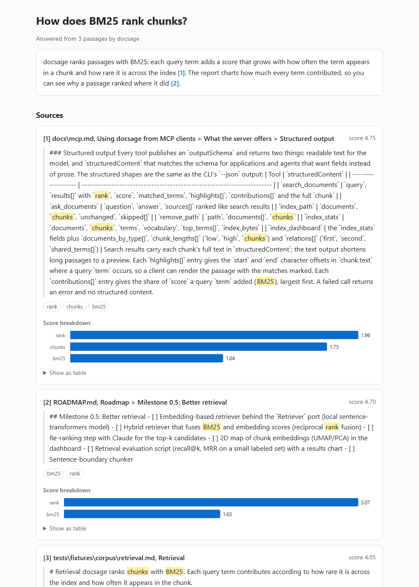
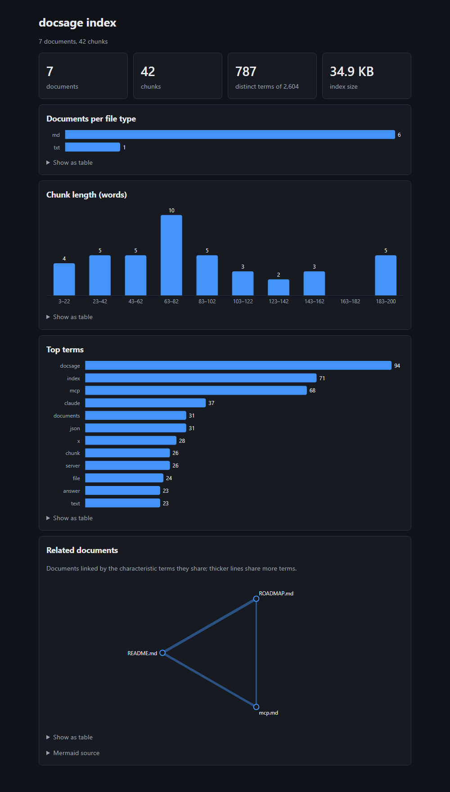

# docsage

Ask questions about your own documents. `docsage` indexes Markdown, text, HTML, Word
(`.docx`) and PDF files, retrieves the most relevant passages with BM25, and asks Claude for an
answer that cites its sources. Common English and Portuguese stopwords are ignored
when ranking, so questions phrased in either language match on their content words.

```bash
pip install -e ".[pdf]"
docsage index ./docs
docsage search "how is the index persisted?"
docsage ask "what chunking strategy does the project use?"
docsage chat                         # follow-up questions keep the conversation
docsage index https://example.com/guide   # web pages too: main content only
docsage remove ./docs/old-notes.md   # or a whole folder
docsage stats                        # documents, chunks, top terms, index size
```

Markdown files are split on their headings, so a chunk never mixes two sections,
and long sections are windowed like any other text. HTML pages (`.html`, `.htm`) get
the same treatment: tags, scripts and styles are stripped, `<h1>`-`<h6>` become the
section headings and `<pre>` blocks keep their lines; it uses only the standard library.
Word documents (`.docx`) are read the same way, also without extra dependencies:
paragraphs styled as headings (or with an outline level, so localized styles such as
"Título 1" work too) become the sections, and table rows become `cell | cell` lines.
Citations point to where a passage came from: the heading path for Markdown, HTML and
Word (`guide.md, Setup > Install`) and
the page for PDFs (`guide.pdf, p. 4` or `guide.pdf, pp. 4-5`), both in the terminal
output and in the passages sent to Claude.

Re-running `index` only processes files whose content changed since the last run;
pass `--force` to rebuild every document.

`index` also takes `http://` and `https://` URLs, mixed with paths. The page is fetched
with the standard library (up to 5 MB, 15 s timeout), and for HTML only the main content
is kept: the `<main>` element, or the `<article>` elements without one, with navigation,
headers, footers, sidebars and forms dropped. It then splits on its headings like a local
page and is cited by URL (`https://example.com/guide, Setup > Install`). Markdown and
plain-text URLs are kept as they are. Pages that cannot be fetched are listed as failed
(and `index` exits with 1) while the rest is still indexed; `docsage remove <url>` drops
a page and every indexed page below that URL. The dashboard counts them as `web`.

`docsage watch <folder>...` indexes the folders like `index` and then keeps the index in
sync while it runs: files that are created or edited are re-indexed, deleted files are
dropped from the index, and unchanged files are skipped by their content hash. It polls
the files every second (`--interval 0.5` to look more often), needs no extra packages,
never looks inside the index's own folder (unless the watched folder is in it), and
stops with Ctrl-C:

```bash
docsage watch docs/ notes.md
# Watching docs, notes.md for changes (Ctrl-C to stop).
# Indexed 12 documents into 87 chunks.
# Indexed 1 documents into 4 chunks.
# Removed docs/old.md.
```

`search`, `ask` and `stats` accept `--json` to print machine-readable output
(ranked chunks with scores, the answer with its cited sources, or the index
summary), handy for scripts and other tools. Each ranked chunk lists its
`matched_terms` and `highlights`: the character offsets in the chunk's text where
a query term occurs (`{"start": 4, "end": 9, "term": "index"}`), normalized the same
way the ranking is, so a viewer can highlight exactly what matched.
Results also carry `contributions`, the BM25 score split by query term
(`{"term": "index", "score": 1.42}`, largest first, summing to `score`), so you can see
why a passage ranked where it did; `docsage search "query" --explain` prints the same
breakdown under each result, and the HTML answer report charts it for every source.

Add `-v`/`--verbose` before the command to log what docsage is doing to stderr,
one `key=value` line per event (documents indexed or skipped, index loads and
saves, retrieval counts, Claude token usage), so stdout stays clean for `--json`:

```bash
docsage --verbose index ./docs
# level=debug logger=docsage.application.services event="indexed document" source=docs/a.md chunks=3
```

### Configuration

Put a `docsage.toml` in the folder you run `docsage` from (or pass `--config path`)
to change the defaults. Every key is optional; command-line flags win over the file.

```toml
index_path = ".docsage/index.json"   # relative paths are resolved from this file's folder
chunk_size = 200                     # words per chunk
chunk_overlap = 40                   # words shared between consecutive chunks
chunker = "window"                   # or "sentence": never cut a sentence in half
model = "claude-opus-5-5"            # model used by `ask`
retriever = "bm25"                   # or "embedding", "hybrid"
embedding_model = "sentence-transformers/paraphrase-multilingual-MiniLM-L12-v2"
rerank = false                       # let Claude reorder the best candidates
rerank_candidates = 20               # how many candidates Claude grades
prompt_cache = true                  # cache the passages sent to Claude
chat_history_turns = 10              # earlier turns `chat` sends with each question
answer_language = ""                 # e.g. "Portuguese"; empty: the question's language
answer_length = "medium"             # or "short", "long"
```

### Chunking

The default `window` chunker cuts text into windows of `chunk_size` words that share
`chunk_overlap` words. The `sentence` chunker packs whole sentences into chunks of at most
`chunk_size` words and repeats the previous chunk's last sentences (up to `chunk_overlap`
words), so passages never stop mid-sentence. Markdown is first split on headings with
either one. Blank lines end a sentence too, and common abbreviations such as "e.g." do
not. Unchanged files keep their chunks, so re-index with `--force` after switching:

```bash
docsage index docs/ --chunker sentence --force
```

### Retrievers

BM25 (the default) ranks by shared words and needs no extra packages. For matches on
meaning rather than exact words, install the embeddings extra and pick the
`embedding` retriever, which ranks chunks by the cosine similarity of their vectors
from a local [sentence-transformers](https://www.sbert.net/) model:

```bash
pip install -e ".[embeddings]"
docsage --retriever embedding search "how do I keep the index small?"
```

Both retrievers read the same index, so you can switch at any time without
re-indexing. Chunks are embedded on the first search and their vectors are cached
next to the index (`index.embeddings.json`), so later runs only embed new or changed
chunks. Embedding results have no per-term score breakdown.

`--retriever hybrid` runs both and fuses their rankings with
[reciprocal rank fusion](https://plg.uwaterloo.ca/~gvcormac/cormacksigir09-rrf.pdf):
each chunk scores `sum(1 / (60 + rank))` over the rankings it appears in, so passages
that match both the words and the meaning of the question come first, and a passage
only one retriever finds still makes the list. Scores are fused ranks, so hybrid
results have no per-term breakdown either.

### Re-ranking with Claude

`--rerank` (or `rerank = true`) adds a second stage to `search`, `ask`, `report` and
the MCP tools: the retriever proposes its best `rerank_candidates` passages, Claude
grades each one from 0 to 10 for how well it answers the query, and the passages are
returned best grade first (ties keep the retriever's order). The score shown is the
grade. It works on top of any retriever and needs Claude API credentials:

```bash
docsage --retriever hybrid --rerank search "how do I keep the index small?"
```

### Evaluating retrieval

`docsage evaluate` measures how well the configured retriever finds the right documents.
Give it a JSON file of labeled queries, each with the sources that answer it (full paths or
path suffixes such as `docs/install.md`):

```json
[{"query": "where is the index stored", "relevant": ["faq.txt"]}]
```

It reports recall@k (the share of relevant documents found in the top k chunks), the
mean reciprocal rank of the first relevant chunk and where each query's first hit landed.
`--format html` draws recall at every cut-off and each query's reciprocal rank as charts;
`--format json` returns the same numbers for scripts. Combine it with `--retriever` and
`--rerank` to compare strategies on the same labels:

```bash
docsage index tests/fixtures/corpus
docsage evaluate tests/fixtures/evaluation.json -k 3
docsage --retriever hybrid evaluate tests/fixtures/evaluation.json --format html -o eval.html
```

`ask` uses the Claude API. Set `ANTHROPIC_API_KEY` (or log in with `ant auth login`)
before running it. `index` and `search` work offline. The answer is streamed to the
terminal as Claude writes it, followed by the list of sources; pass `--no-stream` to
print it only once it is complete (`--json` output is never streamed).
The passages are sent to Claude as their own block, marked for
[prompt caching](https://platform.claude.com/docs/en/build-with-claude/prompt-caching), with the
question after them, so asking again over the same passages within a few minutes reads them
from the cache instead of paying for them in full. `--verbose` logs
`cache_creation_input_tokens` and `cache_read_input_tokens` for each answer; set
`prompt_cache = false` in `docsage.toml` to turn it off. Context shorter than the model's
minimum cacheable prefix is simply not cached.

By default Claude answers in the language of the question, at whatever length the passages
call for. `--language` (any language name Claude understands, e.g. `Portuguese`) makes every
answer use that language whatever the question's, and `--length short` keeps it to two or
three sentences while `--length long` asks for every relevant detail. Both work with `ask`,
`report` and `chat`, and `answer_language` / `answer_length` in `docsage.toml` set them for
every command, the MCP server included:

```bash
docsage ask "how is the index stored?" --language Portuguese --length short
```

### Token usage and cost

Every answer records the tokens Claude spent on it: uncached input, input written to and
read from the prompt cache, and output, plus an estimate of the price in US dollars from
the list prices of the model that actually answered (a fallback model, if the first one
declined). `--usage` on `ask` and `chat` prints it after the sources:

```bash
docsage ask "how is the index stored?" --usage
# Usage: claude-opus-5-5: 4,210 input tokens (3,900 cached), 312 output tokens, ~$0.0083
```

`ask --json` and the MCP `ask_documents` tool always include `usage` and `cost_usd`
(`null` when no passage matched or the model's price is unknown), and `docsage report`
charts the token breakdown under the sources. Prices are estimates from a fixed table;
your bill is the source of truth.

### Chat

`docsage chat` opens an interactive session for questions that build on each other
("which retriever is the default?", then "and how do I switch it?"). Every question
retrieves its own passages, and Claude also gets the earlier questions and answers so
follow-ups make sense. Only the text of old turns is sent, not their passages, and only
the last `chat_history_turns` turns (default 10), so long sessions stay cheap. Answers are
streamed with their sources listed after them. Type `/reset` to start a new conversation
and `/exit` (or Ctrl-D) to leave; `-k` and `--model` work as in `ask`.

### MCP server

`pip install -e ".[mcp]"` adds the official MCP SDK, then `docsage mcp` serves the
index over stdio (global options such as `--index` and `--config` still apply; logs
go to stderr so stdout stays reserved for the protocol):

```bash
docsage --index ~/notes/.docsage/index.json mcp
claude mcp add docsage -- docsage --index ~/notes/.docsage/index.json mcp
```

For clients that connect over the network, `--http` serves Streamable HTTP instead
(default `127.0.0.1:8765`, endpoint `/mcp`; `--host` and `--port` change it):

```bash
docsage --index ~/notes/.docsage/index.json mcp --http --port 8765
claude mcp add --transport http docsage http://127.0.0.1:8765/mcp
```

`--watch <folder>` (repeatable) keeps the index in sync with a folder while the server
runs, as `docsage watch` does, and tells listening clients that `docsage://documents`
changed (see [docs/mcp.md](docs/mcp.md#5-keeping-the-index-in-sync-while-serving)):

```bash
claude mcp add docsage -- docsage --index ~/notes/.docsage/index.json mcp --watch ~/notes
```

The server offers these tools:

| Tool               | What it does                                              |
| ------------------ | --------------------------------------------------------- |
| `search_documents` | ranked passages with citations, no model call             |
| `ask_documents`    | a cited answer from Claude (needs `ANTHROPIC_API_KEY`)    |
| `index_path`       | index a file or folder; unchanged files are skipped       |
| `remove_path`      | drop a file or folder from the index (files stay on disk) |
| `index_url`        | fetch a web page and index its main content               |
| `remove_url`       | drop a web page, and the pages below that URL             |
| `index_stats`      | documents, chunks, top terms and index size               |
| `index_dashboard`  | charts of file types, chunk lengths, top terms, related documents and the chunk map |

In hosts that support [MCP Apps](https://github.com/modelcontextprotocol/ext-apps),
`ask_documents` shows the HTML answer report with highlighted citations and
`index_dashboard` the HTML dashboard, right in the conversation; other hosts get the
same content as text.

It also publishes two read-only resources (JSON), plus the two `ui://` views:

| Resource                      | Contents                                                     |
| ----------------------------- | ------------------------------------------------------------ |
| `docsage://documents`         | every indexed document: chunk count, pages, sections, chunk ids |
| `docsage://chunks/{chunk_id}` | the full text, position and citation of one chunk            |

And two prompts that embed whole documents as numbered, citable passages
(about 60k characters at most; the rest is left out and the prompt says so):

| Prompt               | Arguments         | Asks for                                         |
| -------------------- | ----------------- | ------------------------------------------------ |
| `summarize_document` | `source`          | an overview and key points, citing `[1]`, `[2]`  |
| `compare_documents`  | `first`, `second` | shared topics, agreements, differences (`[A1]`, `[B2]`) |

Pass sources exactly as `docsage://documents` lists them.

Every tool also publishes an output schema and returns `structuredContent` with the
same fields as the CLI's `--json` output, so agents can read scores, citations and
counts without parsing the text.

[docs/mcp.md](docs/mcp.md) walks through the Claude Code, Claude Desktop and HTTP
setup, with every tool's arguments and a troubleshooting list.

### HTTP API

`pip install -e ".[api]"` adds FastAPI and uvicorn, then `docsage serve` serves the index
over HTTP at `http://127.0.0.1:8000` (`--host` and `--port` to change it; global options
such as `--index`, `--retriever` and `--rerank` still apply). Responses use the same JSON
shapes as `--json`, and interactive docs are at `/docs`:

| Endpoint | Does |
| --- | --- |
| `POST /index` | `{"targets": ["docs/", "https://example.com/guide"], "force": false}`: index files, folders and pages |
| `GET /search?q=...&top_k=5` | rank passages, with highlights and score breakdowns (no model call) |
| `POST /ask` | `{"question": "...", "top_k": 5}`: answer with Claude, with sources, usage and cost |
| `GET /stats?top=10` | summarize the index |
| `GET /health` | liveness check |

```bash
docsage serve --port 8000
curl -X POST localhost:8000/index -H "content-type: application/json" -d '{"targets": ["docs/"]}'
curl "localhost:8000/search?q=chunk%20size&top_k=3"
```

Only one indexing request writes at a time. `/ask` needs `ANTHROPIC_API_KEY` in the
server's environment.

#### Web UI

The same server has a minimal web UI: open `http://127.0.0.1:8000/` in a browser. It is
built from the visual renderers below, so every page is a self-contained HTML document
that follows the system's light or dark mode:

| Page | Shows |
| --- | --- |
| `/ui?q=...` | a search form and the ranked passages with highlights and score breakdowns |
| `/ui/ask?q=...` | the answer report for a question ("Ask Claude" on the form) |
| `/ui/dashboard` | the index dashboard |

### Docker

The image serves the HTTP API and web UI on port 8000 with the `api`, `mcp` and `pdf`
extras installed (`--build-arg EXTRAS=api,mcp,pdf,embeddings` adds the embedding
retrievers). It runs as an unprivileged user in `/data`, where the index is stored, so
mount a volume there to keep it; a `docsage.toml` placed in `/data` is picked up too:

```bash
docker build -t docsage .
docker run --rm -p 8000:8000 -e ANTHROPIC_API_KEY -v docsage-index:/data -v "$PWD/docs:/docs:ro" docsage
```

`docker-compose.yml` does the same with a named volume and mounts `./docs` (or the folder
in `DOCSAGE_DOCS`) read-only at `/docs`. Any CLI command runs in a one-off container:

```bash
docker compose up --build -d
docker compose run --rm api index /docs
docker compose --profile mcp up -d
```

The `mcp` profile adds the MCP server over Streamable HTTP at `http://localhost:8765/mcp`,
sharing the index volume; index through one service at a time, since each process saves
the whole index.

### Visual reports

An answer can be rendered as a single, self-contained HTML page: the question, the
answer with each `[n]` citation linked to its passage, and every cited passage with
the matched query terms highlighted. The page inlines its CSS (no network needed) and
follows the system's light or dark mode. A plain-text renderer is the fallback for
clients that cannot show HTML (matched terms appear in `**bold**`).

`docsage report` answers a question with Claude and writes the report: to stdout by
default, to a file with `-o`, or as plain text with `--format text`. `--open` shows it in
the default browser (in a temporary file unless `-o` is given):

```bash
docsage report "How does BM25 work?" --open
docsage report "How does BM25 work?" -o reports/bm25.html
```



From Python:

```python
from pathlib import Path

from docsage.container import Container, load_settings

report = Container(load_settings()).answer_report_service("html").report("How does BM25 work?")
Path("answer.html").write_text(report.content, encoding="utf-8")
```

### Index dashboard

`docsage dashboard` writes a single-file HTML dashboard of the index: totals, documents
per file type, a histogram of chunk lengths (in words) and the most frequent terms. The
charts are inline SVG, so the page works offline, follows light and dark mode, shows
each value on hover and has a "Show as table" view under every chart.

A "Related documents" graph links documents that share characteristic terms (frequent
in the document, rare across the index), with thicker lines for more shared terms. Its
Mermaid source is one click away, and `--format mermaid` prints just that diagram, ready
to paste into a Markdown file or a GitHub issue.

With the `embedding` or `hybrid` retriever, a "Chunk map" places every chunk on a 2D
plane by the meaning of its text: the embeddings are reduced to their two principal
components (PCA, computed in pure Python), so chunks that talk about similar things
sit close together. Each document has its own color (documents past the eighth share
an "Other" color), every dot names its chunk on hover, and the text format draws the
same map as a grid of letters. The BM25 retriever needs no embedding model, so its
dashboard has no map.

```bash
docsage --retriever hybrid dashboard -o dashboard.html
```

```bash
docsage dashboard -o dashboard.html     # then open it in a browser
docsage dashboard --format text         # the same numbers as text bars in the terminal
docsage dashboard --format mermaid      # related documents as a Mermaid graph
```



`python scripts/screenshots.py` regenerates both screenshots from this repository's own
docs with a headless Chrome or Edge and a canned answer, so it needs no API key.

## What's new in 0.7

- HTML (`.html`, `.htm`) and Word (`.docx`) loaders, and web pages by URL
  (`docsage index https://...`, MCP `index_url` / `remove_url`), main content only.
- `docsage watch` keeps the index in sync with folders as files change.
- `docsage serve` exposes `/index`, `/search`, `/ask` and `/stats` over HTTP
  (`docsage[api]`), with a web UI under `/ui` built from the HTML renderers.
- A Dockerfile and a `docker-compose.yml` with the API and an optional MCP service.
- Version tags are published to PyPI by GitHub Actions with trusted publishing.

## What's new in 0.6

- `ask` streams the answer as Claude writes it (`--no-stream` to wait for the whole text).
- The passages sent to Claude are cached, so follow-ups on the same context cost less
  (`prompt_cache = false` to turn it off).
- `docsage chat` keeps the conversation, so follow-up questions make sense.
- `--language` and `--length` (or `answer_language` / `answer_length`) fix how answers read.
- Every answer reports its token usage and estimated cost (`--usage`, JSON, MCP and the
  HTML report).

## What's new in 0.5

- `embedding` and `hybrid` retrievers (`--retriever`, `docsage[embeddings]`): local
  sentence-transformers vectors, fused with BM25 by reciprocal rank fusion.
- `--rerank` lets Claude grade and reorder the best candidates of any retriever.
- The dashboard maps chunk embeddings in 2D (PCA) when an embedding retriever is used.
- `docsage evaluate` measures recall@k and MRR on a labeled query set, as text, JSON or
  an HTML page with charts.
- `index --chunker sentence` keeps every sentence whole inside its chunk.

## What's new in 0.4

- Search results and answers carry highlight offsets and a per-term BM25 score
  breakdown (`search --explain`, JSON and MCP structured output).
- `docsage report` renders an answer as a self-contained HTML page with highlighted
  citations and score charts; `--open` shows it in the browser.
- `docsage dashboard`: an offline HTML dashboard of the index with charts of file
  types, chunk lengths, top terms and a graph of related documents
  (`--format text` and `--format mermaid` too).
- In MCP Apps hosts, `ask_documents` and the new `index_dashboard` tool show those
  HTML pages right in the conversation, following the host's light or dark theme;
  other clients get the same content as text.

## What's new in 0.3

- `docsage mcp` turns the index into an MCP server over stdio, or Streamable HTTP
  with `--http`.
- Tools to search, ask, index, remove and summarize the index, each with an output
  schema and structured content next to the text.
- `docsage://documents` and `docsage://chunks/{chunk_id}` resources, plus
  `summarize_document` and `compare_documents` prompts.
- [docs/mcp.md](docs/mcp.md): setup for Claude Code, Claude Desktop and HTTP clients.
- An integration suite drives the server with an in-memory MCP client.

## What's new in 0.2

- `--json` output for `search`, `ask` and `stats`, for scripts and other tools.
- `docsage.toml` config file for the index path, chunking and model.
- `docsage stats`: documents, chunks, terms, top terms and index size.
- Citations with PDF page numbers and Markdown heading paths; Markdown is chunked
  by section.
- `--verbose` structured (`key=value`) logging on stderr.
- CI runs strict mypy and reports test coverage.

## Architecture

The code follows a ports-and-adapters (hexagonal) layout:

```
src/docsage/
├── domain/           entities (Document, Chunk, Answer) and ports (Protocols)
├── application/      use cases: indexing, removal, stats, question answering, reports
├── infrastructure/   adapters: file loaders, chunker, BM25 retriever, Claude generator,
│                     HTML and plain-text renderers
├── interfaces/       CLI, MCP server and shared JSON serializers
└── container.py      composition root, wires adapters to ports
```

- **Single responsibility.** Each adapter does one job: loading, chunking, ranking or generating.
- **Open/closed.** New file formats or retrievers are new classes that implement a port. Existing code stays untouched.
- **Dependency inversion.** Use cases depend on the Protocols in `domain/ports.py`, never on concrete adapters. That is why the tests can swap in fakes without mocking libraries.

## Development

```bash
pip install -e ".[dev]"
pytest
ruff check .
mypy          # strict type checking of src/, also run in CI
pytest --cov  # coverage report; CI fails below 90% and publishes the summary
```

`tests/unit/` covers each class with fakes. `tests/integration/` drives the MCP server
end to end: one in-memory client session indexes the small corpus in
`tests/fixtures/corpus/`, reads resources, searches, asks and removes, against a real
on-disk index. Only the answer generator is faked (`Container(settings, generator)`),
so no test calls the Claude API.

Pushing a `vX.Y.Z` tag runs the `Release` workflow, which checks that the tag matches
`docsage.__version__`, builds the package and publishes it to PyPI (see
[CONTRIBUTING.md](CONTRIBUTING.md#releasing)).

The project uses [git flow](CONTRIBUTING.md). See the [roadmap](ROADMAP.md) for planned work.

## License

MIT
