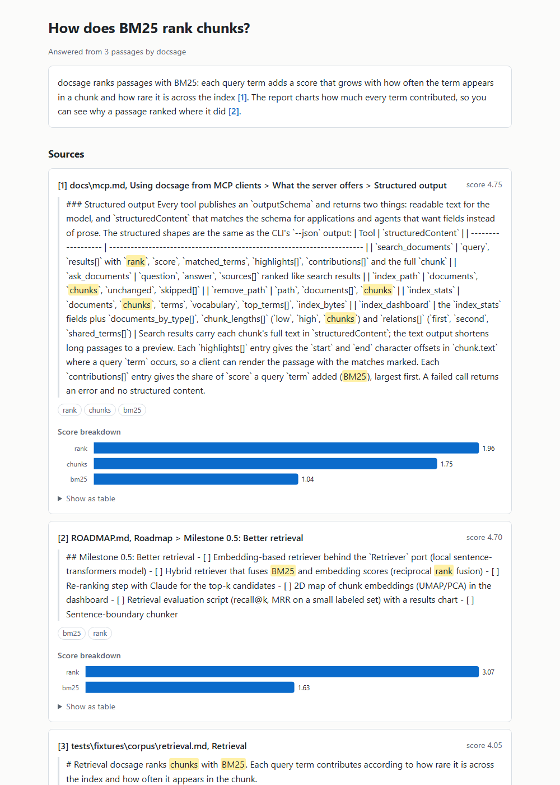

# docsage

**Ask questions about your own documents and get answers that cite their sources.**

Point docsage at your notes, manuals or PDFs and ask in English or Portuguese. Each answer
links to the passages it came from, so you can check it.



## Quickstart

You need Python 3.11 or newer.

```bash
git clone https://github.com/Guilherme-b-damasio/docsage
cd docsage
pip install -e ".[pdf]"
```

Index a folder and search it. This works offline, with no API key:

```bash
docsage index ./my-docs
docsage search "how do I renew my license?"
```

To get written answers, add a Claude API key (or log in with `ant auth login`):

```bash
export ANTHROPIC_API_KEY=sk-ant-...
docsage ask "how do I renew my license?"
```

The index is saved to `.docsage/index.json` in the current folder, so run later commands
from the same place.

## How it works

1. **Index.** docsage splits your documents into short passages and remembers where each
   one came from, such as `guide.md, Setup > Install` or `guide.pdf, p. 4`.
2. **Search.** Your question is compared with every passage, and the best 5 are kept.
3. **Answer.** Claude receives only those passages and is told to answer from them, cite
   them, and say so when the answer isn't there.

**What leaves your computer:** only `ask`, `chat`, `report` and `--rerank` call the Claude
API, and they send the selected passages with your question. If no passage matches,
Claude isn't called at all.

**Search matches exact words by default,** so "renew" won't find "renewal". To match on
meaning, install the `embeddings` extra and add `--retriever hybrid`.

## What you can do

| I want to... | Command |
| --- | --- |
| Ask a question | `docsage ask "..."` |
| Ask follow-up questions | `docsage chat` |
| Find passages without calling Claude | `docsage search "..."` |
| Add a web page | `docsage index https://example.com/guide` |
| Re-index files as they change | `docsage watch ./my-docs` |
| Remove a file or folder from the index | `docsage remove ./my-docs/old.md` |
| Look only in one folder or file type | `docsage ask "..." --source docs/api` or `--source .pdf` |
| Get an answer as an HTML page | `docsage report "..." --open` |
| See what is in the index | `docsage stats` or `docsage dashboard -o dashboard.html` |
| Measure search quality | `docsage evaluate queries.json` |
| Use my documents from Claude Code or Claude Desktop | `docsage mcp` ([setup](docs/mcp.md)) |
| Use a browser or an HTTP API | `docsage serve` ([details](docs/http-api.md)) |

docsage reads Markdown, plain text, HTML, Word (`.docx`) and PDF files, plus web pages.

Some features need an optional extra, installed like `pip install -e ".[mcp]"`:

| Extra | Adds |
| --- | --- |
| `pdf` | PDF files |
| `embeddings` | search by meaning (`--retriever embedding` or `hybrid`) |
| `mcp` | `docsage mcp` |
| `api` | `docsage serve` |

## Docker

This starts the API and web UI at `http://localhost:8000`, then indexes `./docs`:

```bash
docker compose up --build -d
docker compose run --rm api index /docs
```

[Docker options](docs/http-api.md#docker) cover other folders, extras and the MCP server.

## Documentation

| Guide | Covers |
| --- | --- |
| [Usage](docs/usage.md) | indexing, filters, chat, cost, JSON output, `docsage.toml` |
| [Tuning retrieval](docs/retrieval.md) | chunking, retrievers, re-ranking, evaluation |
| [Reports and dashboard](docs/reports.md) | HTML and Markdown answers, comparisons, charts of the index |
| [MCP](docs/mcp.md) | Claude Code, Claude Desktop and HTTP clients |
| [HTTP API, web UI and Docker](docs/http-api.md) | running docsage as a server |
| [Changelog](CHANGELOG.md) | what changed in each version |
| [Roadmap](ROADMAP.md) | planned work |
| [Contributing](CONTRIBUTING.md) | development setup, architecture, releases |

## License

MIT
