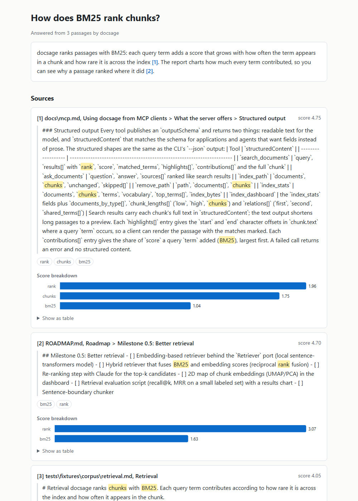
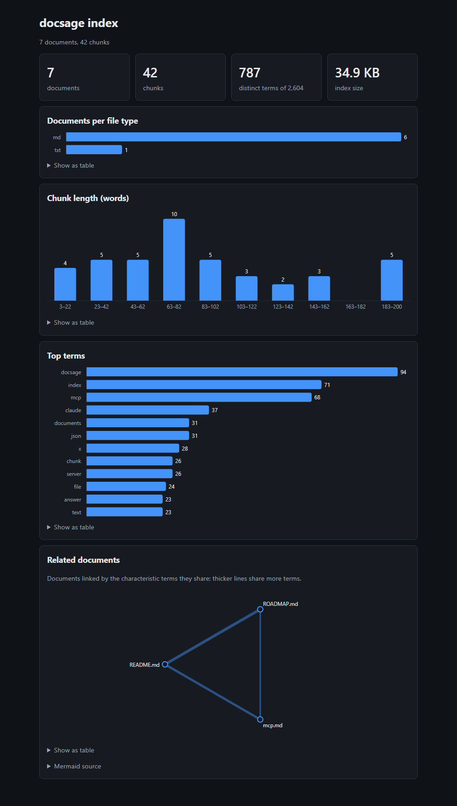

# Reports and dashboard

Turn an answer or the whole index into a page you can read and share.

## Answer reports

An answer can be rendered as a single, self-contained HTML page: the question, the
answer with each `[n]` citation linked to its passage, and every cited passage with
the matched query terms highlighted. The passages are grouped under the document they
come from, with the number of passages it contributed and when it was indexed, and the
most recently indexed document leads, so the freshest material is on top (the `[n]`
markers keep the ranks the answer cites them by). Each passage's citation links to its
source: the web page it came from, or the file on disk (`file://`, opened at the page for
PDFs, with relative paths resolved from the directory docsage runs in). The page inlines
its CSS (no network needed) and follows the system's light or dark mode. A plain-text
renderer is the fallback for clients that cannot show HTML (matched terms appear in
`**bold**`).

`docsage report` answers a question with Claude and writes the report: to stdout by
default, to a file with `-o`, as plain text with `--format text`, or as Markdown with
`--format markdown`. `--open` shows it in the default browser (in a temporary file unless
`-o` is given):

```bash
docsage report "How does BM25 work?" --open
docsage report "How does BM25 work?" -o reports/bm25.html
docsage report "How does BM25 work?" --format markdown -o notes/bm25.md
docsage report "How does BM25 work?" --self-contained -o reports/shared.html
```

`--self-contained` makes the HTML report shareable: every cited document is read back and
inlined in the page with its cited passages marked in place, and each citation points at
that copy instead of at a file, so the report can be attached to an email or committed to
a repository and still show each citation in its context. Sources that cannot be inlined
(web pages, PDFs and Word files, documents that changed since they were indexed) keep
their ordinary link. The flag applies to `--format html` only.

`--compare SETTING=VALUE` answers the question twice, once with the current settings and
once with that setting changed, and shows both answers side by side, so you can see how a
retrieval choice changes what is retrieved and what Claude says. The page opens with how
many passages both answers share (and the overlap as a percentage), then puts each answer
in its own column under a label such as `hybrid, top 10, reranked from 20`, with its cited
passages; a passage both sides retrieved is marked "in both". The columns stack on narrow
screens. Repeat the flag to change several settings at once; the ones that can change are
`top_k`, `retriever`, `rerank`, `rerank_candidates`, `model`, `answer_language` and
`answer_length` (anything that would need a re-index, such as the chunker, cannot).
`--format text` prints the same comparison as plain text, and `--source` narrows both
answers to the same part of the index:

```bash
docsage report "How does BM25 work?" --compare retriever=hybrid --open
docsage report "How does BM25 work?" -k 3 --compare top_k=10 --compare rerank=true -o cmp.html
docsage report "How does BM25 work?" --compare answer_length=short --format text
```

The Markdown report suits notes, wikis and pull requests: each `[n]` in the answer links
to its passage, the passages sit under a heading per cited document (newest first) and
every passage is a quote with the matched terms in `**bold**` under a heading that links
to its source, followed by its score breakdown and the token usage.

### Screenshot



### From Python

```python
from pathlib import Path

from docsage.container import Container, load_settings

report = Container(load_settings()).answer_report_service("html").report("How does BM25 work?")
Path("answer.html").write_text(report.content, encoding="utf-8")
```

## Index dashboard

`docsage dashboard` writes a single-file HTML dashboard of the index: totals, documents
per file type, a histogram of chunk lengths (in words) and the most frequent terms. The
charts are inline SVG, so the page works offline, follows light and dark mode, shows
each value on hover and has a "Show as table" view under every chart.

Right under the totals, "Recently indexed" lists the newest documents first, with when
each one was indexed (UTC) and how many chunks it was split into. docsage records the
time on every chunk as it indexes; documents indexed by an older version show "unknown"
until they are re-indexed (`docsage index --force`).

A "Related documents" graph links documents that share characteristic terms (frequent
in the document, rare across the index), with thicker lines for more shared terms. Its
Mermaid source is one click away, and `--format mermaid` prints just that diagram, ready
to paste into a Markdown file or a GitHub issue.

With the `embedding` or `hybrid` retriever, a "Chunk map" places every chunk on a 2D
plane by the meaning of its text: the embeddings are reduced to their two principal
components (PCA, computed in pure Python), so chunks that talk about similar things
sit close together. Each document has its own color (documents past the eighth share
an "Other" color), every dot names its chunk on hover, and the text format draws the
same map as a grid of letters. The BM25 retriever needs no embedding model, so its
dashboard has no map.

```bash
docsage --retriever hybrid dashboard -o dashboard.html
```

```bash
docsage dashboard -o dashboard.html     # then open it in a browser
docsage dashboard --format text         # the same numbers as text bars in the terminal
docsage dashboard --format mermaid      # related documents as a Mermaid graph
docsage dashboard --format pdf -o index.pdf   # the HTML dashboard as one PDF
```

`--format pdf` prints the HTML dashboard to a single PDF (to `dashboard.pdf` unless `-o`
says otherwise) with a local headless Chrome, Chromium or Edge, so it can be attached to
an email or printed. The page is pinned to the light theme, and cards and charts are kept
whole across page breaks. docsage looks for the browser on `PATH` and in the usual install
locations; `--browser PATH` names one explicitly. Nothing is sent over the network.

### Screenshot and regeneration



`python scripts/screenshots.py` regenerates both screenshots from this repository's own
docs with a headless Chrome or Edge and a canned answer, so it needs no API key.
